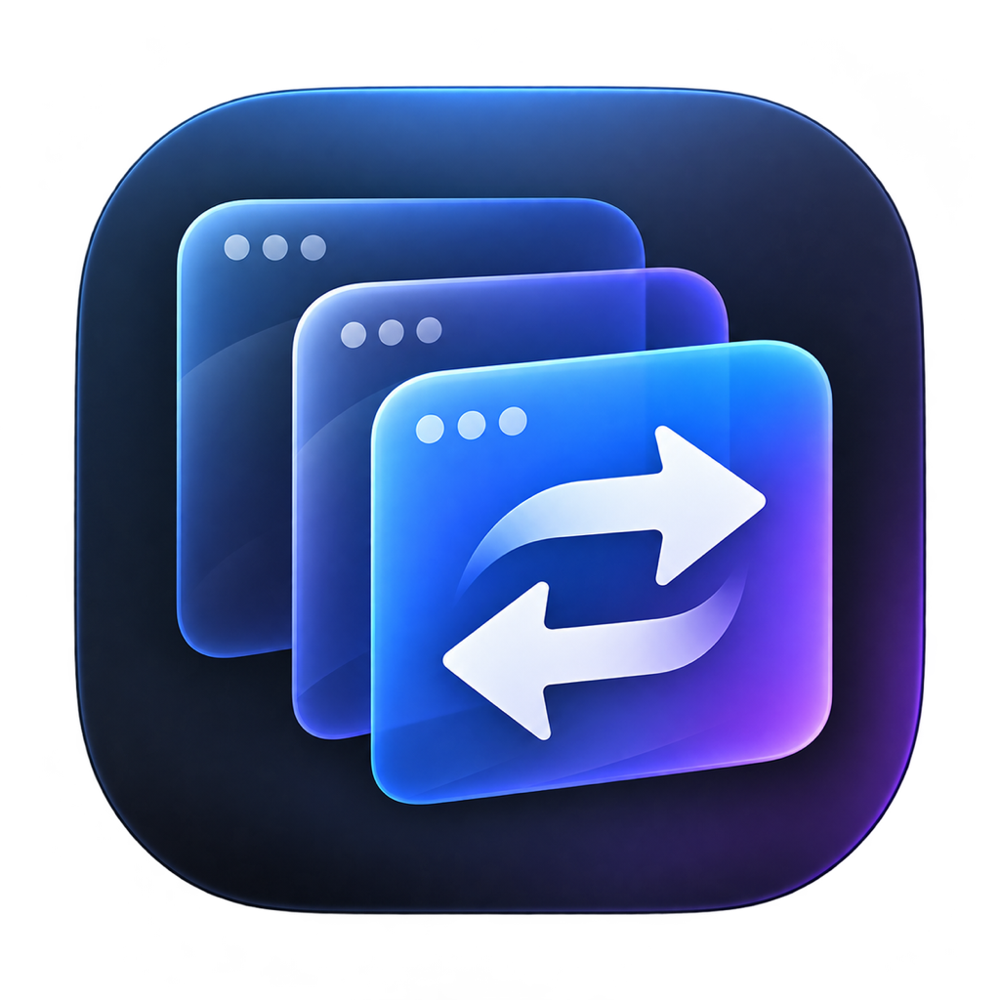

<div align="center">
  

  # AltTabber

  **A fast, visual window switcher for macOS.**

  Switch between the windows you actually want—not just the apps that own them.

  
  
  

  <br><br>

  [](https://github.com/Lee337/alt-tabber/releases/latest/download/AltTabber-v0.5.4-macOS.pkg)
</div>

---

AltTabber brings a visual, window-first workflow to **Option-Tab**. Hold **Option**, tap **Tab** to move through live previews, then release **Option** to bring the selected window forward.

No Electron. No web runtime. Just native Swift, AppKit, SwiftUI, and ScreenCaptureKit.

## Download

Download the installer, open it, and macOS places AltTabber in your Applications folder:

### [Install AltTabber v0.5.4 for macOS](https://github.com/Lee337/alt-tabber/releases/latest/download/AltTabber-v0.5.4-macOS.pkg)

1. Download and open the installer.
2. Follow the macOS installation prompt.
3. Open **AltTabber** from Applications and grant Accessibility and Screen Recording access when requested.

Prefer a portable archive? [Download the ZIP instead](https://github.com/Lee337/alt-tabber/releases/latest/download/AltTabber-v0.5.4-macOS.zip), unzip it, and move **AltTabber.app** into Applications.

> [!IMPORTANT]
> This early release is ad-hoc signed and the installer is not yet notarized by Apple. macOS may show a security warning. If it does, Control-click the downloaded installer and choose **Open**, or use **System Settings → Privacy & Security → Open Anyway**. A Developer ID-signed and notarized release is planned.

## Why AltTabber?

macOS normally switches between applications. That becomes awkward when one app has several windows—a Downloads folder, two browser windows, a project in Xcode, and a document you were editing five minutes ago.

AltTabber puts every window on equal footing:

- **Real window switching** — each open window gets its own card.
- **Live visual previews** — recognize content before reading a title.
- **Fast repeat launches** — previews are cached for ten minutes, while switched windows refresh immediately.
- **Useful titles** — see `Downloads`, document names, and active browser-window titles.
- **Multi-row grid** — scan many windows without an endless horizontal carousel.
- **Native performance** — built entirely with Apple frameworks.
- **Your preferred layout** — choose a wrapping grid or horizontal strip.

## Highlights

| | Feature | What it gives you |
|---|---|---|
| 🪟 | Window-first switching | Move between individual windows instead of application groups |
| 🖼️ | Live previews | ScreenCaptureKit thumbnails captured concurrently for every eligible window |
| ⌨️ | Familiar shortcut | `⌥ Tab` forward, `⇧ ⌥ Tab` backward, release `⌥` to select |
| 🧩 | Flexible layouts | Configurable grid columns, horizontal mode, and three preview sizes |
| 🖥️ | Multi-display support | The switcher appears on the display under your pointer |
| 🚀 | Launch at Login | Keep AltTabber ready from the moment you sign in |
| 🎯 | Clickable cards | Keyboard when you want speed; pointer when you want precision |

## Build from source

### Requirements

- macOS 14 or newer
- Xcode or the Swift 6 command-line toolchain

### Build and launch

```sh
git clone https://github.com/Lee337/alt-tabber.git
cd alt-tabber
make test
make app
make installer
open dist/AltTabber.app
```

The generated application is available at `dist/AltTabber.app`.

> [!NOTE]
> Local builds are ad-hoc signed. For distribution outside your Mac, use an Apple Developer ID certificate, the hardened runtime, and notarization.

## Controls

| Action | Shortcut |
|---|---|
| Open and cycle forward | `⌥ Tab` |
| Cycle backward | `⇧ ⌥ Tab` |
| Switch to selected window | Release `⌥` |
| Cancel | `Esc` |
| Open without the shortcut | Menu bar → **Show Window Switcher** |

## Make it yours

Open **Settings…** from the menu-bar icon to configure:

- Grid or horizontal layout
- Two to six grid columns
- Compact, standard, or large previews
- Window-title visibility
- Launch at Login

The default layout is a four-column wrapping grid designed to keep a large window collection readable at a glance.

## Permissions

AltTabber asks only for the macOS permissions required by its native features:

| Permission | Used for | Without it |
|---|---|---|
| **Accessibility** | Raising and focusing the exact selected window | AltTabber can activate the app, but exact window focus may be limited |
| **Screen Recording** | Capturing live window thumbnails and richer titles | Window cards fall back to application icons |

Permission prompts are not repeatedly opened when access is missing. Use the menu-bar permission actions or **Settings…** to request access again.

After changing either permission, quit and reopen AltTabber so macOS refreshes the authorization state.

### If Screen Recording looks enabled but previews are missing

Local macOS privacy records can become stale after an application is rebuilt or re-signed. Remove the existing AltTabber entry from:

**System Settings → Privacy & Security → Screen & System Audio Recording**

Then add `/Applications/AltTabber.app` again, enable it, and relaunch AltTabber.

## Project structure

```text
Sources/AltTabber/
├── AppDelegate.swift              App lifecycle, menu bar, and orchestration
├── GlobalShortcutMonitor.swift    Native Option-Tab registration
├── WindowService.swift            Window discovery, previews, titles, and focus
├── SwitcherPanelController.swift  Multi-display overlay positioning
├── SwitcherModel.swift            Selection and window state
├── SwitcherView.swift             SwiftUI window grid and cards
├── SettingsView.swift             Appearance and permission settings
└── AppSettings.swift              Persistent preferences and runtime status
```

The project uses Swift Package Manager and has no third-party runtime dependencies.

## Development

```sh
make build   # Debug build
make test    # Run the test suite
make app     # Create a signed release app bundle
make installer # Create a macOS installer package in dist/
make run     # Build and open the app
make clean   # Remove local build output
```

If full Xcode is installed at `/Applications/Xcode.app`, the build scripts select it automatically to avoid conflicts with an older standalone Command Line Tools installation.

## Status

AltTabber is an actively evolving personal utility. Expect the core workflow to work, but treat the current releases as early builds while shortcut behavior, capture performance, and permission handling continue to mature.

Ideas, bug reports, and pull requests are welcome.

<div align="center">
  <sub>Built for people with more windows open than they care to admit.</sub>
</div>
